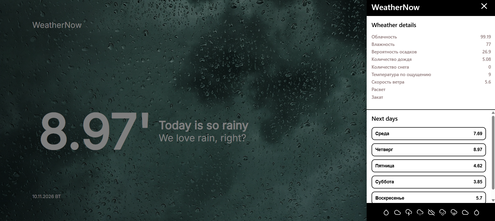

# 🌦️ WeatherNow — Приложение для прогноза погоды

**WeatherNow** — мой личный pet-проект, представляющий собой веб-приложение для просмотра текущей погоды и прогноза на ближайшие дни.

Основная цель проекта — предоставить пользователям удобный и наглядный интерфейс для получения актуальной информации о погодных условиях. Приложение отображает текущую температуру, облачность, влажность, вероятность осадков, скорость ветра и другие погодные показатели.


## 📸 Скриншот проекта



## ✨ Основные возможности

- **Текущая погода** — отображение температуры и текущих погодных условий.
- **Подробная информация** — влажность, облачность, вероятность осадков, количество дождя и снега, скорость ветра и ощущаемая температура.
- **Прогноз на ближайшие дни** — просмотр погодных условий на несколько дней вперёд.
- **Дополнительная панель** — подробная информация о погоде и прогнозе.
- **Динамический интерфейс** — визуальное оформление, адаптирующееся под погодные условия.
- **Адаптивный дизайн** — корректное отображение приложения на различных устройствах.

## 🛠️ Используемые технологии

- **React 18** — разработка пользовательского интерфейса.
- **JavaScript (ES6+)** — основная логика приложения.
- **React Router DOM** — маршрутизация.
- **TanStack Query (React Query)** — получение и управление серверными данными.
- **Axios** — выполнение HTTP-запросов к API.
- **Material UI (MUI)** — готовые компоненты интерфейса.
- **Emotion** — стилизация компонентов.

## ⚙️ Установка и запуск

1. Клонировать репозиторий:

   ```bash
   git clone YOUR_REPOSITORY_LINK
   ```

2. Перейти в папку проекта:

   ```bash
   cd weather-now
   ```

3. Установить зависимости:

   ```bash
   npm install
   ```

4. Запустить проект:

   ```bash
   npm start
   ```

5. Открыть приложение в браузере:

   ```text
   http://localhost:3000
   ```

## 🎯 Цель проекта

Проект разработан в рамках самостоятельной практики (Pet Project) для закрепления навыков работы с React, изучения взаимодействия с внешними API, обработки асинхронных запросов и создания интерактивных пользовательских интерфейсов.

В процессе разработки были закреплены навыки работы с компонентной архитектурой React, TanStack Query, Axios и Material UI.
